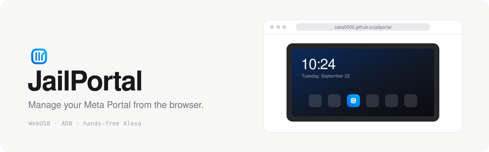

<picture>
  <source media="(prefers-color-scheme: dark)" srcset="docs/banner-dark.svg">
  
</picture>

Install apps on a Meta Portal, mirror its screen and poke around its shell, straight from a browser tab. It talks ADB over WebUSB, so there is nothing to install on your computer and no server in the middle.

JailPortal is a fork of [OpenPortal](https://github.com/andronedev/openportal) by andronedev that adds **hands-free Alexa** for Portals running Android 10.

**→ [zaka0002.github.io/jailportal](https://zaka0002.github.io/jailportal/)**

## What you can do

- Install apps from a community catalog, or drop any `.apk` on the page
- Launch, stop, clear or uninstall what's already on the device
- Mirror and control the screen (scrcpy)
- Browse files, open a shell, read logcat, edit feature flags *(Advanced mode)*
- **Say "Alexa" again**: one-click install of [Réveil Alexa](https://github.com/zaka0002/reveil-alexa), with every permission set for you

## Hands-free Alexa

Meta removed Alexa from the Portal, and on Android 10 the original client can't be restored without root (it needs the system-only `CAPTURE_AUDIO_HOTWORD` permission). The Amazon Alexa app installs fine, but its hands-free mode is disabled on the Portal.

[Réveil Alexa](https://github.com/zaka0002/reveil-alexa) fills the gap:

- Listens for "Alexa" offline with [Vosk](https://alphacephei.com/vosk/) and a small French model. Nothing leaves the device.
- Only fires on a finished "Alexa" with high confidence, said at the end of what you say, so TV and conversation don't set it off.
- Beeps and opens Alexa's voice screen, then gives the mic back to Alexa.
- Android 10 on the Portal silences a background app's microphone every so often. Réveil Alexa notices and takes it back within about a second.

From the catalog, JailPortal installs it, grants the microphone, lets it open Alexa from the background, exempts it from battery optimisation and starts it. It asks for **Amazon Alexa 2.2.508613.0** first: that's the version known to open its voice screen on the Portal.

## Getting started

1. On the Portal: **Settings → Debug → ADB Enabled**.
2. Plug it into your computer with a USB‑C **data** cable. The port is on the back, sometimes under a cover.
3. Open [zaka0002.github.io/jailportal](https://zaka0002.github.io/jailportal/) in Chrome, Edge or any Chromium browser, then click **Connect**.

Every Portal model works. Firefox and Safari don't support WebUSB.

> [!WARNING]
> Don't change **Display size** in the Portal's own Settings. It can put the device in a boot loop ([OpenPortal #10](https://github.com/andronedev/openportal/issues/10)). If ADB is still enabled, `adb shell wm density reset` brings it back. Otherwise only a factory reset will.

## Add your app

The catalog is plain JSON in [`catalog/`](catalog/): one folder per app, added by pull request with no code change. See [catalog/README.md](catalog/README.md).

## Development

```bash
pnpm install
pnpm dev        # http://localhost:5173, add ?demo to run without a device
pnpm lint && pnpm build
```

React, Vite, TypeScript, Tailwind and [ya-webadb](https://github.com/yume-chan/ya-webadb). The build is a static site. More in [CONTRIBUTING.md](CONTRIBUTING.md).

## Notes

Meta [officially opened ADB](https://developers.meta.com/horizon/blog/build-apps-for-portal-with-ai/) on Portal. JailPortal only uses public ADB commands: no exploit, no root, no bootloader unlock. Screen mirroring ships the [scrcpy](https://github.com/Genymobile/scrcpy) server (v2.3, Apache‑2.0), pushed on demand and never modifying the device. The brand uses Meta's blue palette; JailPortal is not affiliated with Meta or Amazon.

MIT licensed, like OpenPortal. Original work © andronedev and the OpenPortal contributors.
